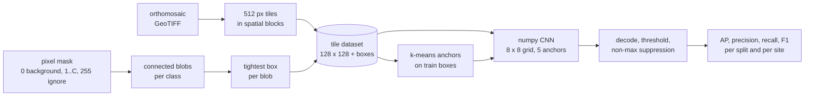

# glassbox-ml

This project builds a data pipeline for high-resolution orthomosaics 
and an object detector for trash in drone imagery from scratch, without 
PyTorch, TensorFlow, scikit-learn, or OpenCV. 
Convolution, backpropagation, Adam, the detection loss, non-max
suppression, average precision, connected-component labelling, polygon
rasterization and the shapefile parser are all functions in this repository.

Only three third-party packages are imported besides numpy, each confined to one
file and none of them doing any learning:

| Package | Used for | Confined to |
| --- | --- | --- |
| rasterio | decoding windows of multi-gigabyte GeoTIFFs | `glassbox/data/raster_io.py` |
| PyYAML | reading config files | `glassbox/config.py` |
| matplotlib | drawing boxes on tiles | `glassbox/viz.py` |

## Written from scratch

| Piece | Where | How it is checked |
| --- | --- | --- |
| Convolution, max-pool, LeakyReLU, forward and backward | `glassbox/nn/layers.py` | finite differences in float64; a four-loop convolution; an adjoint test |
| SGD, Momentum, RMSprop, Adam | `glassbox/optim/optimizers.py` | first two steps worked by hand |
| Grid encoding and decoding of boxes | `glassbox/detection/encoding.py` | encode then decode returns the boxes |
| Detection loss and its gradient | `glassbox/detection/loss.py` | finite differences, relative error below 1e-7 |
| IoU, non-max suppression, k-means anchors | `glassbox/detection/boxes.py`, `anchors.py` | hand-computed cases; planted clusters recovered |
| Precision, recall, F1, average precision | `glassbox/detection/metrics.py` | hand-computed curves |
| Connected components | `glassbox/data/components.py` | `scipy.ndimage.label` on random masks |
| Polygon rasterization | `glassbox/data/rasterize.py` | GDAL, pixel for pixel |
| `.shp` / `.dbf` parsing | `glassbox/data/shapefile.py` | geopandas |

scipy, GDAL and geopandas appear only in the tests.

## The pipeline



There are three main scripts driven by a layered YAML config:
`scripts/build_dataset.py`, `scripts/train.py` and `scripts/evaluate.py`.

## Design notes

### Semantic segmentation vs object detection

Fuzzy human annotations in QGIS motivate an object-based approach to trash
detection, so this pipeline converts `(image tile, mask tile)` pairs cut from 
drone orthomosaics with a list of boxes.

1. **Remap.** A `label_remap` in the config sends raw mask values to classes.
   The default collapses the nine trash classes into one. A raw value that is
   not listed (tires, nodata) becomes *ignore*: it is never boxed, and it is
   never called background either.
2. **Label blobs.** Each class's pixels are grouped into 8-connected components.
3. **Box.** Each blob becomes the tightest rectangle that contains
   all of its pixels.
4. **Filter.** A tile is kept only if it is clean background or has at least one
   box. Tiles whose only content is ignored pixels, or blobs too small to box,
   are left out.

The component labeller reduces each row to runs of
consecutive foreground pixels, then merges overlapping runs
of adjacent rows. Because both rows are
sorted, the merge is a two-pointer sweep, so the cost scales with the number of
runs (not number of pixels).

### Testing convolution as one matrix product

After `im2col` copies every f x f patch of the padded input into a row, which turns
the layer into `cols @ W`, the backward pass needs the transpose of that copy.
The usual check for a backward pass is finite differences, but
`col2im` should also be the adjoint of `im2col`, and that is a property that can be tested directly
without a cost function:

$$\langle \mathrm{im2col}(x),\, y \rangle = \langle x,\, \mathrm{col2im}(y) \rangle \quad \text{for random } x, y$$

Note that we can disregard the first convolution's input gradient, 
which removes the largest `col2im` of every backward pass.

### The detection head

The network is fully convolutional: four `CONV 3x3 -> LeakyReLU -> MAXPOOL`
stages (16, 32, 64, 128 filters) take a 128 x 128 tile down to an 8 x 8 grid, a
further 3 x 3 convolution mixes features at grid resolution, and a 1 x 1
convolution emits the predictions. With five anchors and one class this is
248,249 parameters.

Each (cell, anchor) slot predicts an objectness logit and a box, decoded as

$$b_x = (c_x + \sigma(t_x))\,s, \qquad b_y = (c_y + \sigma(t_y))\,s, \qquad b_w = a_w e^{t_w}, \qquad b_h = a_h e^{t_h}$$

where $(c_x, c_y)$ is the cell, $s$ the cell size and $(a_w, a_h)$ the anchor.
The cost for one image is

$$
\begin{aligned}
J ={} & \lambda_{obj}\sum_{obj}\mathrm{BCE}(t_o, 1) + \lambda_{noobj}\sum_{noobj}\mathrm{BCE}(t_o, 0) \\
& + \lambda_{coord}\sum_{obj}\Big[(\sigma(t_x)-y_x)^2 + (\sigma(t_y)-y_y)^2 + (t_w-y_w)^2 + (t_h-y_h)^2\Big] \\
& + \lambda_{class}\sum_{obj}\mathrm{CE}(\mathrm{softmax}(c),\, y_c)
\end{aligned}
$$

and its gradient with respect to every output is derived by hand in
`YoloLoss.backward`.

### Splitting by block instead of by tile

Neighbouring tiles show the same street and sometimes the same object cut in
two. To avoid neighbours landing in different splits and the dev set partly
measuring memorization, tiles are grouped into 8 x 8 blocks and a whole
block goes to train, dev, or test. Dev and test are drawn by the same shuffle of
the same blocks within every site so they share a distribution, and
evaluation is run on each site separately as well as pooled.

The test split is only ever scored at a threshold chosen on dev.

## Config-driven experiments

Every setting lives in YAML, with `configs/base_config.yaml` holding the defaults and
an experiment merging a small override file on top in this order:

```bash
python scripts/train.py --config configs/base_config.yaml --override configs/sherlock/sherlock.yaml --override configs/experiments/wide.yaml
```

```yaml
# configs/experiments/wide.yaml
project:
  run_name: "wide"

model:
  stages: [32, 64, 128, 256]
  head_channels: 256
```

| Section | Controls |
| --- | --- |
| `paths` | where the image/mask pairs are and where datasets + runs go |
| `data` | tile size, decimation, block size, blob filters, background sampling, split |
| `classes` | raw mask value to class, class names |
| `model` | filters per stage, head width, anchors per cell |
| `loss` | the four weights of the cost |
| `training` | epochs, batch size, optimizer and its hyperparameters |
| `evaluation` | checkpoint, splits, score threshold, NMS and IoU thresholds |

## Running it

Use the same config chain for all three commands:

```bash
python scripts/build_dataset.py --override my_paths.yaml
```

```bash
python scripts/train.py --override my_paths.yaml
```

```bash
python scripts/evaluate.py --override my_paths.yaml
```

where `my_paths.yaml` sets `paths.base_path` (a folder holding
`data/images/<site>_image.tif` and `data/masks/<site>_mask.tif`) and
`paths.output_path`. The imagery itself is not part of this repository,
and commands are meant to be run via sbatch jobs in [sherlock/](sherlock/README.md) 
which run each stage on a SLURM cluster.

To run the tests:

```bash
pytest
```

## Concurrent work

The baseline intentionally has no regularization, no augmentation, no
learning-rate decay and no batch norm. Modularized development is continuing:

| Technique | Where it goes |
| --- | --- |
| L2 regularization | A function `penalty(parameters) -> float` passed to `Trainer(penalties=[...])`. It returns the extra cost and adds its gradient to each `param.grad`; `param.kind` tells weights from biases. `tests/test_pipeline.py` has a working example |
| Dropout | A new `Layer`. `forward(x, training)` already receives the train/test switch |
| Batch norm | A new `Layer` with `gamma`, `beta` as `Parameter`s and running statistics returned from `buffers()`, which checkpoints already save |
| Learning-rate decay | `Trainer(lr_schedule=lambda epoch: ...)` |
| Early stopping | Return `True` from the `on_epoch_end` callback |
| Another optimizer | Subclass `Optimizer` and write `update` |
| Data augmentation | Transform the batch in `Trainer.train_step` before `encode_targets` |
| A different architecture | Another builder next to `build_detector`; anything that is a `Sequential` trains |

## Layout

```
glassbox/
  nn/          Parameter, Layer, Sequential; Conv2D, MaxPool2D, LeakyReLU; He init; gradient checking
  optim/       SGD, Momentum, RMSprop, Adam
  detection/   IoU and NMS; k-means anchors; grid encoding/decoding; the loss; metrics; the model
  data/        shapefile reader; polygon rasterizer; connected components; tiling and splits; the builder
  train/       the training loop, checkpoints, inference over a dataset
  config.py    layered YAML configs
configs/       base_config.yaml, plus sherlock/ and experiments/ overrides
scripts/       build_dataset.py, train.py, evaluate.py
sherlock/      sbatch jobs for each stage
tests/         gradient checks and reference comparisons
```
